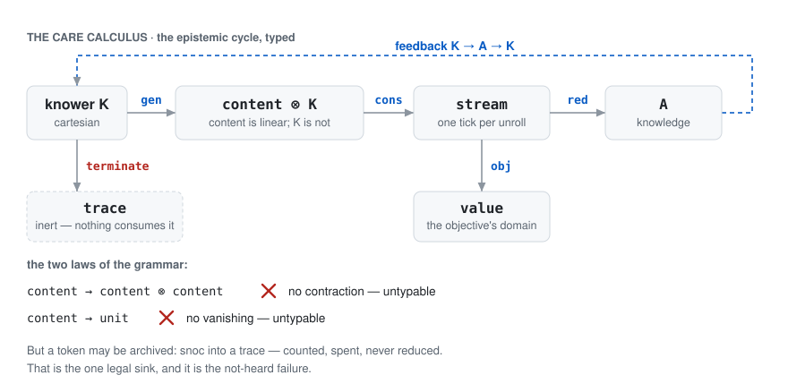
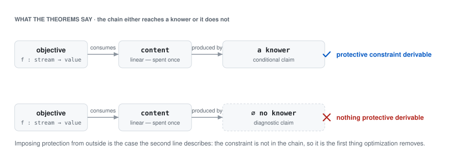

# The Care Calculus

Artifact for the paper `paper/paper.md`:

> *The Care Calculus: A Mechanized Linear Type Theory for Safe Agents*

**Published: concept doi [10.5281/zenodo.24122159](https://doi.org/10.5281/zenodo.24122159)** —
it always resolves to the latest archived version. Cite the paper by the concept DOI.

A multi-sorted linear logic with coalgebraic generators, guarded recursion, and
resource-linear destructors, mechanized in Lean 4 (4.35.0, no Mathlib) as **two
formal systems**: the *unrestricted* calculus (the adversarial baseline) and the
*Guarded* kernel.

In the kernel both linearity laws are absolute theorems of the grammar — a
derivation of contraction would *be* a cloner, and a derivation of vanishing would
*be* an eraser. Unrestricted, the guard is gone and they are not free: **vanishing
is refuted**, by a machine-checked counterexample (`extractor_exists`) — an
explicit `[content] ⊢ unit` derivation whose lete/pair exchange spends the token —
while contraction remains the open named conjecture (`no_contraction_content`).
The counterexample is the point of shipping both systems: the boundary between
them is measured, not asserted.

<picture>
  <source media="(prefers-color-scheme: dark)" srcset="diagrams/calculus-dark.svg">
  
</picture>

The two claims are about where a reduction chain ends. If it reaches the minds
whose content the objective consumes, a protective constraint is derivable from
the objective's own structure; if it never does, nothing protective is derivable
at all, and a constraint imposed from outside is the first thing optimization
removes.

<picture>
  <source media="(prefers-color-scheme: dark)" srcset="diagrams/chains-dark.svg">
  
</picture>

## Layout

| path | contents |
|---|---|
| `paper/paper.md` | the paper (markdown — the source of truth) |
| `diagrams/` | the two figures above as SVG, each a light/dark pair selected with `<picture>` |
| `paper.pdf` | the paper rendered to PDF, generated from `paper/paper.md`: `pandoc paper/paper.md --pdf-engine=typst -o paper.pdf` |
| `lean/` | the Lean 4 development — the library `Dcare`, the two formal systems (`Dcare/Adversarial/` the Extractor baseline, `Dcare/Kernel/` the Guarded kernel), the sequent-calculus presentation (`Dcare/SC.lean`), and `Audit.lean` (the axiom audit, run by the gate and not part of the library) |
| `scripts/lean-check.sh` | the gate: build, axiom audit (no `T2_postulate`, no `sorryAx` outside the named conjectures), no public file importing the restricted companion |
| `scripts/sync-check.sh` | the paper gate: every backtick-quoted identifier in the paper matches a real declaration in `lean/Dcare/` |

## Building and checking

Lean is pinned by `lean/lean-toolchain`; `elan` supplies it.

```
cd lean && lake build          # 28 jobs, no dependencies, ~50 s cold
cd .. && ./scripts/lean-check.sh   # build + axiom audit + disclosure check
./scripts/sync-check.sh            # paper anchors vs real declarations
```

**One anchor is currently unbacked, and the gate says so.** `sync-check.sh` fails
on `no_vanishing_noweak`, cited in the paper's §5 fragment record: that name is
recorded in `Dcare/SC.lean` only inside a documentation block, and no theorem in
the built library carries a `NoWeak` hypothesis. The neighbouring fragments the
same sentence cites — `no_vanishing_clean` (Path.lean), `no_vanishing_of_zeroWeak`
(SC.lean), `no_vanishing_fix_conditional` (Chase.lean) — all resolve. The gate
fails rather than passing, and the count is reported: that is the gate working.

The audit is per-theorem: every public theorem's axiom list is printed, and
only the standard three (`propext`, `Classical.choice`, `Quot.sound`) are
permitted, plus `sorryAx` for the statements on the named allowlist. The
check that "the paper does not depend on the collaboration" is the absence of
`T2_postulate` from every printed axiom list.

## Scope

The paper's §16 states the tiered disclosure: the calculus, every
definition, the diagnostic specification, the theorems at the interface
level, the failure modes, and the scope limits are published here. Withheld
are the concrete constraint-type assignment and the constructive
instantiation of `SelfClassifies` and `ArmedSetup` — a companion that exists,
is checked to compile separately against these interfaces, and is not part of
this repository or of the public build.

## License

Deliberately non-permissive, by content type:

- **`paper/paper.md`, `paper.pdf` and any figures** — CC-BY-NC-SA-4.0
  (see `LICENSE-paper`).
- **The Lean development (`lean/`) and the gates (`scripts/`)** —
  AGPL-3.0-or-later (see `LICENSE`).

The NonCommercial and ShareAlike terms and the network copyleft are the
point: this work is a dual-use artifact, and it is not offered for
incorporation into commercial systems.

## Status

Prepared for public release as a preprint plus its mechanization. Copyright
holder Jaye Timothy Marshall, ORCID [0009-0002-5209-8161](https://orcid.org/0009-0002-5209-8161).
`.zenodo.json` carries the deposit metadata. Deposited on Zenodo as
[10.5281/zenodo.24122160](https://doi.org/10.5281/zenodo.24122160) (v1.0.0);
the concept DOI above covers later versions. The deposit carries `paper.pdf`
and the archived tree `coglib-v1.0.0.zip`.
